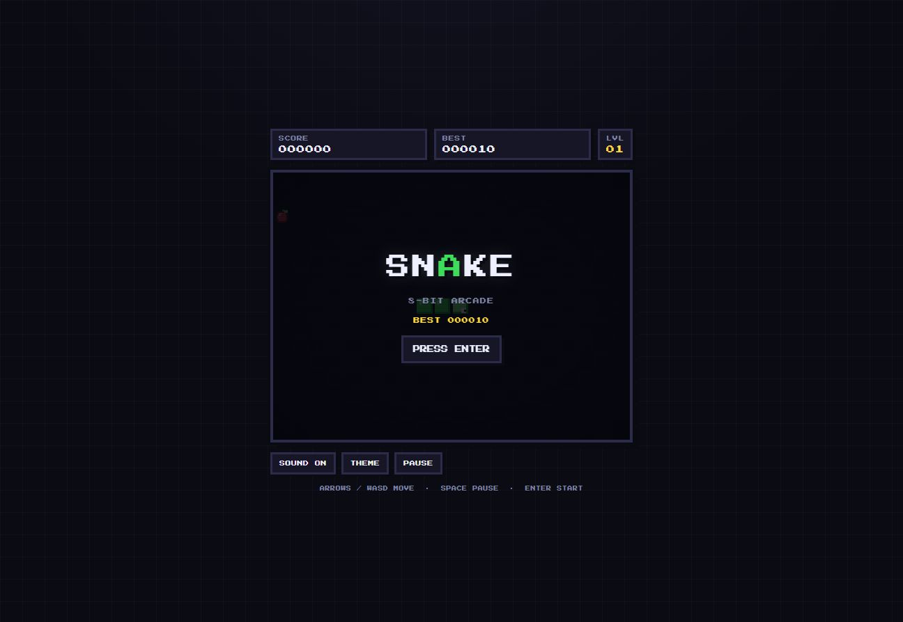

<h1 align="center">🐍 SNAKE — 8-BIT</h1>

<p align="center">
  
</p>

<p align="center">
  <a href="https://SharkCode2020.github.io/snake-8bit/"><b>▶ Play it live</b></a>
</p>

A tiny retro snake game that fits in a single HTML file — no build step, no dependencies, no framework. Canvas pixel art, chiptune blips, CRT scanlines, and a mouse-steering mode with full 360° turns.

## Play

Open `index.html` directly in a browser, or play online:
`https://SharkCode2020.github.io/snake-8bit/`

## Controls

| Action | Keyboard |
| --- | --- |
| Start / restart | `Enter` |
| Move (key mode) | `Arrows` / `WASD` |
| Pause / resume | `Space` / `P` / `Esc` |
| Toggle mouse steering | `C` |
| Mute sound | `M` |
| Switch palette | `T` |

On mobile: swipe the board or use the D-pad.

**Mouse mode** - press `C` or the MODE button. The snake turns toward your cursor at a fixed rate with full 360° steering, so you can carve smooth curves instead of snapping to the grid.

## Gameplay

- Apples **+10** · golden fruit **+50** (expires after 8 seconds)
- **Walls wrap** — leave one edge and you come out on the opposite one, so only your own body can end a run
- Every 5 pickups raises the level and the speed
- High score is saved in `localStorage` (per device / browser)
- Two palettes: **NES** and **CGA**
- Mode can be switched mid-run without losing your score

## Run locally

Just open the file, or serve the folder:

```sh
npx serve .
```

## Hosting on GitHub Pages

This repo is ready to go:

1. **Settings → Pages**
2. Source: **Deploy from a branch**
3. Branch: **main**, folder **/ (root)** → **Save**

The site appears at `https://SharkCode2020.github.io/snake-8bit/` within a minute or so.

### Free `js.org` subdomain

Once the site is live you can request a nicer URL like `snake8bit.js.org`:

1. Add a file named `CNAME` containing your chosen subdomain (e.g. `snake8bit.js.org`).
2. Fork [js-org/js.org](https://github.com/js-org/js.org), add your record under `cnames/`, and open a pull request.

While the request is pending, GitHub will redirect your `github.io` link to the custom domain, so do this once you're ready to share the new URL.

---

Made for fun. No tracking, no build tools, no framework — just one file.
